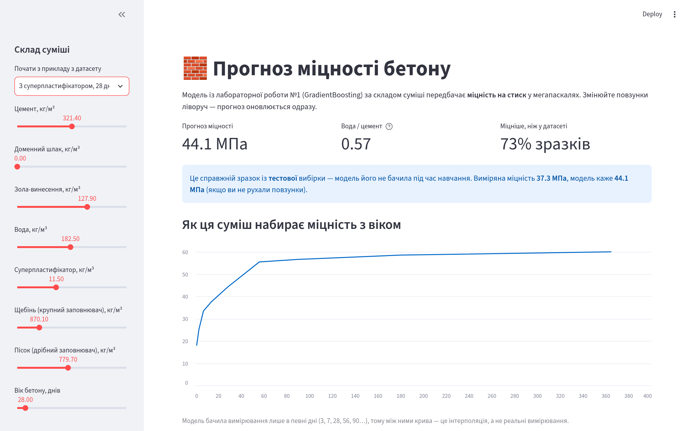

# Прогноз міцності бетону: від Jupyter Notebook до веб-додатку

**Живе демо:** _посилання з'явиться після розгортання_

Модель GradientBoosting прогнозує **міцність бетону на стиск** (МПа) за складом суміші
(R² = 0.94 на тестових даних). Тут модель «виходить» із ноутбука: зберігається у файл
і працює у двох веб-інтерфейсах — Streamlit і Gradio.

Демо до доповіді Knowledge sharing (тема 14: «Від Jupyter Notebook до веб-додатку:
базове розгортання моделей») з курсу «Основи машинного навчання», ХНУ ім. В. Н. Каразіна.
Автор — Гаврась Павло, КС-31.



## Що де лежить

| Файл | Що робить |
|---|---|
| `train_model.py` | Крок 1: навчає модель ЛР1 і зберігає весь `Pipeline` у `model/concrete_model.joblib` |
| `features.py` | Функція нової ознаки «вода/цемент» — потрібна і для навчання, і для застосунку |
| `app_streamlit.py` | Крок 2: повноцінний застосунок на Streamlit (повзунки, приклади, графік, CSV) |
| `app_gradio.py` | Той самий прогноз на Gradio — для порівняння (≈30 рядків) |
| `model/model_meta.json` | Межі ознак, метрики, версія scikit-learn, дата навчання |
| `model/test_examples.csv` | Тестова вибірка — приклади, яких модель не бачила |
| `requirements.txt` | Зафіксовані версії бібліотек (для Streamlit і хостингу) |
| `requirements-gradio.txt` | Те саме + Gradio |

## Запуск

```bash
python -m venv .venv && source .venv/bin/activate
pip install -r requirements.txt
python train_model.py           # Test R2 ≈ 0.94, MAE ≈ 2.5 МПа (модель уже є в model/)
streamlit run app_streamlit.py  # http://localhost:8501

pip install -r requirements-gradio.txt
python app_gradio.py            # http://127.0.0.1:7860
```

## Головні уроки

1. **Зберігати весь `Pipeline`, а не лише модель.** Інакше застосунок «забуде» про масштабування чи нові ознаки.
2. **Власні функції — в окремому модулі.** pickle/joblib зберігає не код функції, а посилання на неї.
3. **Фіксувати версії.** Модель, збережена в одній версії scikit-learn, у іншій може не завантажитись або давати інші відповіді.
4. **Не довіряти чужим `.pkl`/`.joblib`.** Завантаження такого файлу може виконати довільний код.
5. **Показувати межі моделі.** Застосунок попереджає, коли введені дані виходять за межі навчальних.

## Дані

[Concrete Compressive Strength](https://archive.ics.uci.edu/dataset/165/concrete+compressive+strength),
UCI Machine Learning Repository (автор — I-Cheng Yeh, 1998; ліцензія CC BY 4.0):
1030 вимірювань, після видалення 25 повних дублікатів — 1005.
